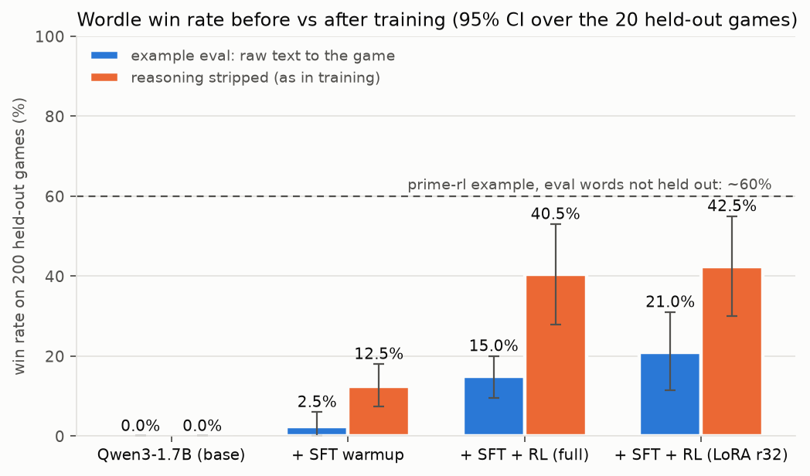
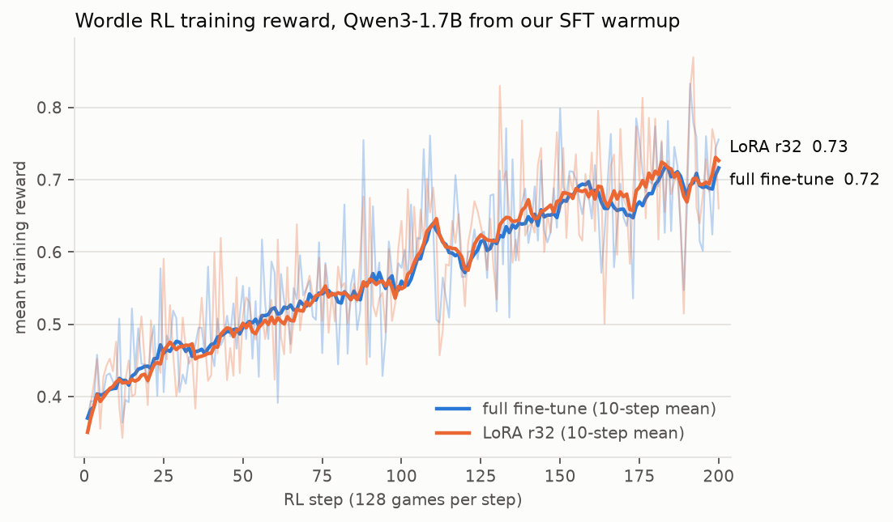
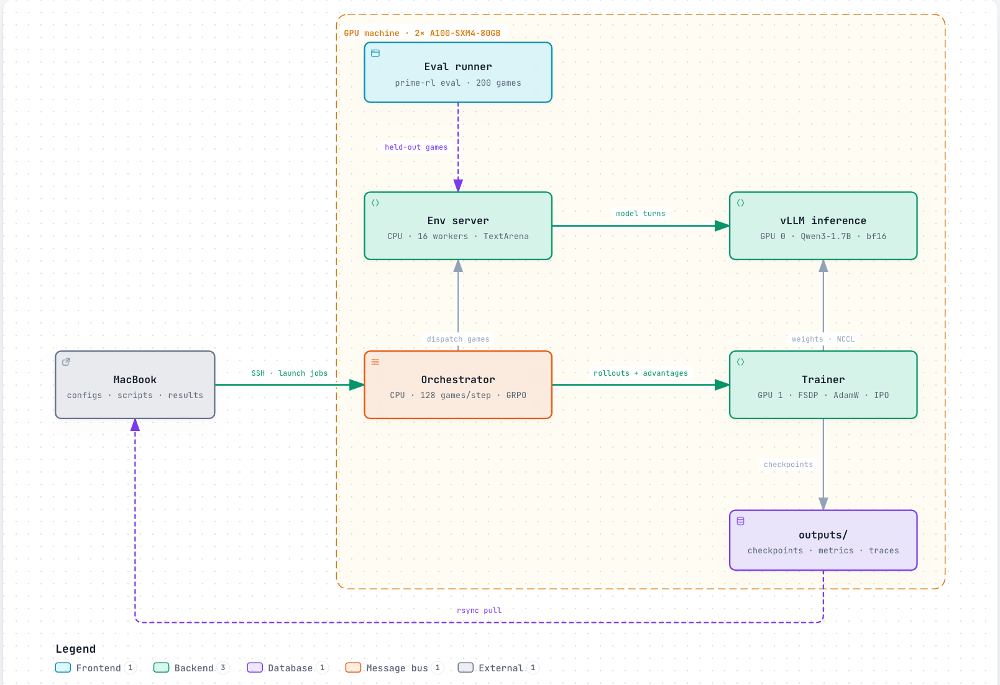

# Teaching Qwen3-1.7B to play Wordle

SFT warmup plus RL with [prime-rl](https://github.com/PrimeIntellect-ai/prime-rl), on the verifiers `wordle` taskset. Win rate is measured on 20 games whose secret words are never seen in training.

**Result:** 0% → **41–45.5%** wins on prime-rl's example eval with structured-thinking SFT plus RL (run 3 and a rerun), up from 15–21% for plain SFT plus RL. Earlier models reach 40.5–42.5% when the game sees only their final answer, so like for like the structured runs are level with them. The model now wins about 88% on its 138 training words but about 41% on new ones.



## Results

200 held-out games (20 words × 10 tries), temperature 1.0, 1,024 tokens per turn. The 95% interval resamples the 20 games.

| Model | Win rate, example eval | Win rate, thinking removed | Avg reward (example / removed) |
|---|---|---|---|
| Qwen3-1.7B base | 0% | 0% | 0.17 / 0.21 |
| + SFT warmup | 2.5% | 12.5% | 0.30 / 0.40 |
| + RL, full fine-tune | 15.0% (10–20) | 40.5% (28–53) | 0.43 / 0.66 |
| + RL, LoRA r32 | 21.0% (12–31) | **42.5%** (30–55) | 0.47 / 0.65 |
| + RL, per-turn credit (run 2) | 17.0% (10–24) | 41.5% (28–56) | 0.45 / 0.64 |
| Structured-thinking SFT (run 3) | 11.5% (5–20) | 0.5%† | 0.42 / 0.24 |
| + RL, reweighted per-turn credit (run 3) | **45.5%** (30–61) | 2.5%† | 0.66 / 0.29 |
| + same RL, rerun on a second machine | 41.0% (28–56) | 5.5%† | 0.66 / 0.33 |

† Not comparable. With the parser on, the eval client sends earlier turns back without their thinking. The structured models were only trained on games that keep it, and without it they stop giving an answer. Training and the example eval both keep it.



Full tables: [results/results.md](results/results.md). One-page summary: [notes/REPORT.md](notes/REPORT.md). Next steps: [notes/IDEAS.md](notes/IDEAS.md) (top idea: a wider secret-word pool).

## The task

- Each game is a seeded TextArena `Wordle-v0` board. The model reasons, then guesses a word in brackets (`[crane]`), and gets G/Y/X feedback for each letter.
- Six guesses. One invalid move (repeat, non-word, wrong length) gets a warning; a second ends the game.
- Reward is 1.0 for a win, otherwise `(greens + 0.5 × yellows) / 5` of the last valid guess.

## What we found

1. **The eval read moves out of the model's thinking.** The example eval server has no reasoning parser, so the game takes the first bracketed word anywhere in the reply, often a guess quoted mid-thought. Training strips the thinking. Adding `--vllm.reasoning-parser qwen3` to the eval server is the only change between the two result columns.
2. **The example's eval words weren't held out.** The secret words come from only 156 nouns, eval seeds 0–19 are also the first training seeds, and 98 of the 1,000 SFT games end on eval words. We held the 18 eval words out of both SFT and RL ([configs/heldout_split.json](configs/heldout_split.json)).
3. **The first RL models didn't memorize.** They do no better on training words than on held-out words.
4. **LoRA matched full fine-tuning** step for step, using 9 GiB of trainer memory instead of 30.
5. **In the first RL models, about 1 turn in 5 ran out of the 1,024-token budget** mid-thought.
6. **Turns-to-solve didn't drop** (about 4.1–4.6 guesses per win in every model).
7. **Per-turn credit fixed validity, not wins.** Cut-off turns fell from 15% to 1.4% and invalid-move losses from 88 to 39 of 200, but the win rate held at about 41%: the model now runs out of guesses because its information-gain bonus favors exploratory guesses over consistent ones ([notes/REPORT.md](notes/REPORT.md)).
8. **Structured thinking helped clue use (run 3).**
   - **SFT data:** 2,560 solver-played games on training words. Each turn's thinking writes down the clue state, spells the candidate out, then checks length, repeats and every clue, in about 90 tokens instead of about 400.
   - **RL:** run 2's per-turn setup, with the clue-violation penalty raised (0.2 → 0.5) and the information-gain bonus cut (0.5 → 0.1).
   - **Result:** 33% of later guesses fit every earlier clue, against 20–22% for the earlier models (25% in the rerun).
9. **Run 3 learns its training words.** A rerun with fewer failed training games scored 41.0%, level with the first run. Over its last 10 steps, with no failed games, it won 88% of training-word games against 41% held out, a far wider gap than the earlier models showed. Training games go through prime-rl's rollout path rather than the eval harness, so the two aren't identical measurements.
10. **Writing the checks isn't doing them.** After SFT alone, the model marks every check ✓, yet only 11% of its later guesses fit the clues; 57% follow a wrong clue summary. A first version of the data without length or repeat checks lost about half its games to invalid moves, mostly wrong-length words.

## Training schedule

| Stage | Data | Steps × batch | LR | Wall time |
|---|---|---|---|---|
| SFT warmup | 902 games (willcb/V3-wordle, eval words removed) | 20 × 64 | 1e-5 | 7.5 min |
| RL, full fine-tune | 5,325 held-out-safe seeds | 200 × 128 (8 words × 16 tries) | 1e-6 | 3.6 h |
| RL, LoRA r32 α64 | same | 200 × 128 | 1e-5 | 4.7 h |
| RL, per-turn credit (run 2) | same | 200 × 128 | 1e-6 | 2.5 h |
| Structured-thinking SFT (run 3) | 2,560 solver-played games, eval words removed | 40 × 64 | 1e-5 | 11 min |
| RL, reweighted per-turn credit (run 3) | same seeds | 200 × 128 | 1e-6 | 5.0 h* |
| Same RL, rerun on a second machine | same seeds | 200 × 128 | 1e-6 | 2.3 h* |

Each RL step uses prime-rl's IPO loss with GRPO advantages: reward minus the mean of the 16 tries at the same word. Runs 2–3 also give each turn its own advantage (`turn_grpo`, [patches/](patches/)). Context is 8,192 tokens per game.

\* Both run 3 machines lost rollouts to inference outages (see below): about a quarter of each step's on the first, and 7,073 in total on the second, mostly between steps 60 and 130. prime-rl drops failed rollouts, and an outage is more likely to catch a long (usually losing) game, so run 3's training reward is likely biased upward and is left out of the plot. The held-out evals ran afterwards with no failures.

## Architecture

<picture>
  <source media="(prefers-color-scheme: dark)" srcset="results/plots/architecture-dark.png">
  
</picture>

The env server runs each game and calls vLLM for every model turn; the orchestrator batches finished games, computes group advantages and feeds the trainer. Diagram made with [archify](https://github.com/tt-a1i/archify).

## What broke

| Problem | Fix |
|---|---|
| prime-rl at this commit needs CUDA 13 | `nvidia/cuda:13.0.1-cudnn-devel-ubuntu24.04`, hosts with CUDA ≥ 13 drivers |
| `uv run` refetched wheels from GitHub (504s) | `UV_NO_SYNC=1` after setup |
| Triton couldn't compile its helper | install `python3.12-dev` |
| One env worker: 0.87 s per new game stalled the rest | static pool of 16 workers (3.5 min → 70 s per step) |
| 21 GB checkpoints on a 100 GB disk | delete optimizer state after export |
| First weight sync hung on GPUs without NVLink | set `NCCL_P2P_DISABLE=0 NCCL_SHM_DISABLE=0` before launch |
| Container CPU cap (20.5 and 30.7 CPUs) with one Python process started per game: vLLM missed health checks and rollouts failed | not fixed; lowering the game workers' priority helped briefly. Needs games without a new process each, or fewer workers |
| Run 3's first SFT data never checked length or repeats | spell each candidate out and check those first |

## Reproduce

```bash
make setup                                   # Mac tooling (uv)
make split                                   # held-out split → configs
make gpu-offers PROFILE=wordle HOURS=9       # list 2-GPU offers; nothing is rented
make gpu-up OFFER=<id> HOURS=9 && make gpu-setup
make data eval-base sft eval-sft rl eval-rl rl-lora eval-lora
make rl-turns eval-turns                     # run 2: per-turn credit
make cot-data && make run3                   # run 3: structured-thinking data (on the Mac), then SFT, RL, evals
make gpu-down PHASE=4 && make report
```

`make help` lists every target. Pinned: prime-rl `1e53181`, verifiers `2cb0a6d`, torch 2.13+cu130, vLLM 0.31, textarena 0.7.4.
